# Relatório de Bugs — SIFIT

**Sistema:** SIFIT — Gestão de Academias
**Ambiente:** sifit.centrion.com.br (homologação)
**Período de execução:** 22/10/2026
**Responsável:** Eduardo

---

### BUG-001 — Auditoria de acesso não registra logins desde 03/2023

**Severidade:** Alta — a ausência de trilha de auditoria de acesso
compromete a rastreabilidade em caso de incidente de segurança.
**Prioridade:** Alta
**Módulo:** Autenticação / Auditoria

**Pré-condição:** Possuir credenciais válidas e acesso de leitura ao banco.

**Passos para reprodução:**
1. Autenticar no sistema com credenciais válidas
2. Executar no banco:
   `SELECT MAX(created_at) AS ultimo, COUNT(*) AS total FROM log_login;`

**Resultado esperado:** Novo registro na tabela `log_login` contendo
data e hora do acesso. O sistema possui a estrutura para esse registro
e a utilizou até 24/03/2023.

**Resultado obtido:** Último registro em 24/03/2023, total de 247
registros. O acesso realizado em 22/10/2026 não foi persistido.

**Verificação complementar:** foram consultadas as demais tabelas de
log do schema (`logs`, `automacao_logs`, `auditoria_financeira`). A
tabela `logs` registra operações financeiras com dados recentes
(até 21/10/2026), confirmando que o mecanismo de auditoria do sistema
permanece ativo e que a falha é específica do módulo de autenticação.

**Evidências:**

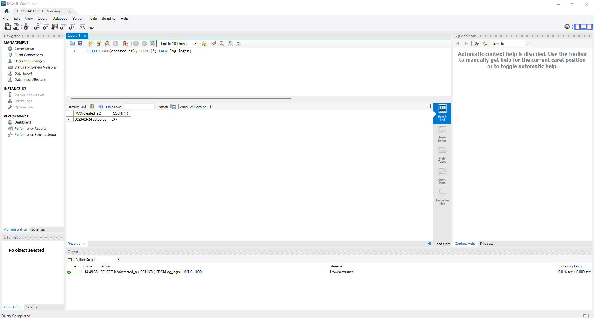

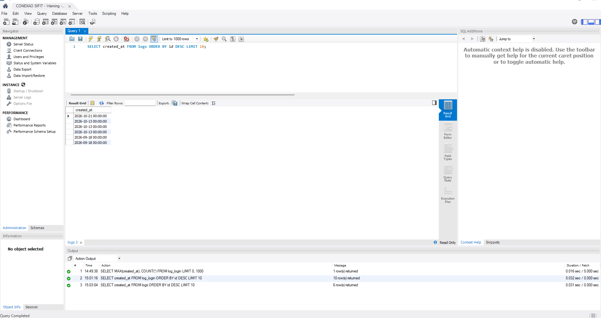

### BUG-002 — Registros de auditoria não armazenam precisão de horário

**Severidade:** Média — compromete a reconstrução cronológica de
eventos, especialmente em operações financeiras.
**Prioridade:** Média
**Módulo:** Auditoria

**Pré-condição:** Acesso de leitura ao banco de dados.

**Passos para reprodução:**
1. Executar no banco:
   `SELECT created_at FROM log_login ORDER BY id DESC LIMIT 10;`
2. Executar no banco:
   `SELECT created_at FROM logs ORDER BY id DESC LIMIT 10;`

**Resultado esperado:** Registros de auditoria contendo data e horário
completos do evento, permitindo identificar o momento exato da ação.

**Resultado obtido:** Todos os registros apresentam horário fixo. Na
tabela `log_login` o valor é sempre `03:00:00`; na tabela `logs`,
sempre `00:00:00`. O padrão corresponde a meia-noite em UTC e em
horário local (UTC-3), indicando que apenas a data é efetivamente
persistida.

**Impacto:** Sem o horário, não é possível determinar a ordem dos
eventos ocorridos em um mesmo dia nem identificar o turno responsável
por uma operação. A limitação é relevante na tabela `logs`, que
registra exclusões de contas a receber e contas a pagar.

**Abrangência:** O comportamento foi verificado em duas tabelas
distintas, indicando tratar-se de característica sistêmica e não de
falha pontual.

**Evidências:**

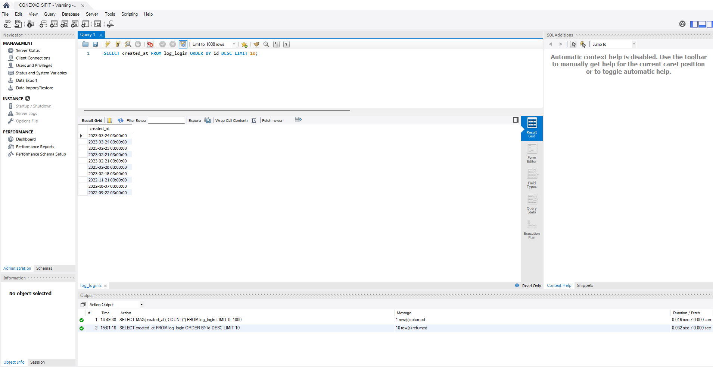

---

### BUG-003 — Modelagem não permite registrar tentativas de acesso malsucedidas

**Severidade:** Média — impede a detecção de tentativas de acesso
não autorizado.
**Prioridade:** Média
**Módulo:** Autenticação / Auditoria
**Classificação:** Limitação de projeto (melhoria), não defeito de execução.

**Pré-condição:** Acesso de leitura ao banco de dados.

**Passos para reprodução:**
1. Executar no banco: `DESCRIBE log_login;`
2. Analisar as colunas disponíveis

**Resultado esperado:** Estrutura capaz de registrar tanto acessos
bem-sucedidos quanto tentativas recusadas, permitindo a identificação
de padrões de tentativa de invasão.

**Resultado obtido:** A tabela `log_login` possui apenas as colunas
`id`, `empresa_id`, `login_id`, `ip` e `created_at`. Não há campo
indicando o resultado da tentativa. Além disso, `login_id` referencia
um usuário cadastrado, de modo que tentativas com usuário inexistente
não teriam como ser registradas.

**Impacto:** Ainda que o registro de acessos voltasse a funcionar
(ver BUG-001), a auditoria cobriria somente autenticações
bem-sucedidas. Ataques de força bruta ou tentativas com usuários
inválidos não deixariam rastro.

**Recomendação:** Inclusão de coluna de status (sucesso/falha) e de
campo textual para o identificador informado, independentemente de
corresponder a um usuário existente.

**Evidências:**

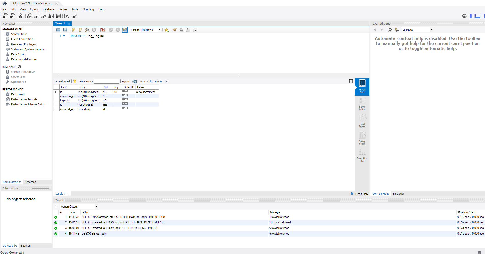

### BUG-004 — Link "Esqueci minha senha" não executa nenhuma ação

**Severidade:** Alta — impede o acesso autônomo ao sistema,
podendo deixar funcionários impossibilitados de trabalhar até
que um administrador redefina a senha manualmente.
**Prioridade:** Alta
**Módulo:** Autenticação

**Pré-condição:** Acessar a tela de login sem estar autenticado.

**Passos para reprodução:**
1. Acessar sifit.centrion.com.br/login
2. Clicar no link "Esqueci minha senha"

**Resultado esperado:** Exibição de formulário para solicitação de
redefinição de senha.

**Resultado obtido:** Nenhuma ação é executada. O elemento apresenta
feedback visual de link ativo (alteração de cor no hover e cursor
pointer), porém o clique não produz navegação nem abertura de
formulário.

**Análise técnica:** O elemento é renderizado como `<a href="#">` sem
manipulador de evento associado. A âncora vazia aponta para a própria
página, o que explica a ausência de resposta ao clique. A estrutura
sugere que a funcionalidade de recuperação de senha não foi
implementada, sendo o elemento apenas um placeholder visual. A
hipótese é reforçada pela ausência, na tabela `login`, de campo
destinado a token de redefinição.

**Impacto:** Usuários que esqueçam a senha não dispõem de meio
autônomo de recuperação, dependendo de intervenção manual do
administrador.

**Evidências:**

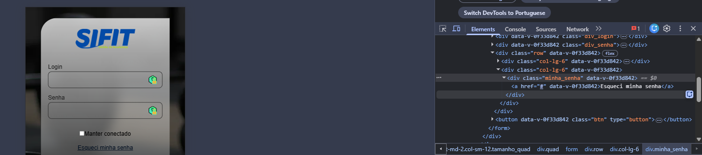

### BUG-005 — Contas vencidas permanecem com status "pendente", ocultando inadimplência do painel gerencial

**Severidade:** Alta — impede a visualização correta da inadimplência
pelo gestor, afetando decisões de cobrança.
**Prioridade:** Alta
**Módulo:** Financeiro / Contas a Receber

**Pré-condição:** Acesso ao sistema e ao banco de dados.

**Passos para reprodução:**
1. Acessar a Página Inicial e observar o card "Total em aberto"
2. Observar o painel "Mensalidades pendentes", que exibe registro
   vencido em 12/05/2026
3. Executar no banco:
   `SELECT COUNT(*), SUM(valor_receber) FROM contas_receber
    WHERE empresa_id = 1 AND status = 'pendente'
    AND data_vencimento < CURDATE();`

**Resultado esperado:** Contas com data de vencimento anterior à data
atual devem ser classificadas com status "vencido" e computadas no
indicador de valores em aberto.

**Resultado obtido:** 192 contas totalizando R$ 32.900,99 permanecem
com status "pendente" apesar de vencidas. O card "Total em aberto"
exibe R$ 0,00.

**Análise técnica:** O sistema possui o status "vencido" (1.098
registros, com vencimentos entre 06/03/2019 e 30/03/2023), o que
indica que a reclassificação já existiu. A totalidade dos registros
atualmente em "pendente" encontra-se vencida, sugerindo interrupção
da rotina responsável pela atualização de status.

**Impacto:** A contradição é visível na própria interface: o card
exibe R$ 0,00 em aberto enquanto o painel lateral lista mensalidade
vencida e recomenda a cobrança de um aluno.

**Evidências:**

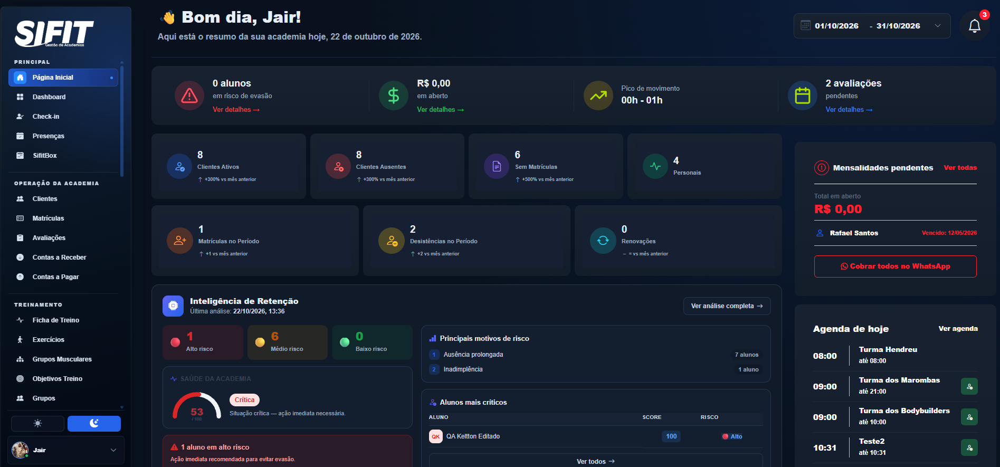

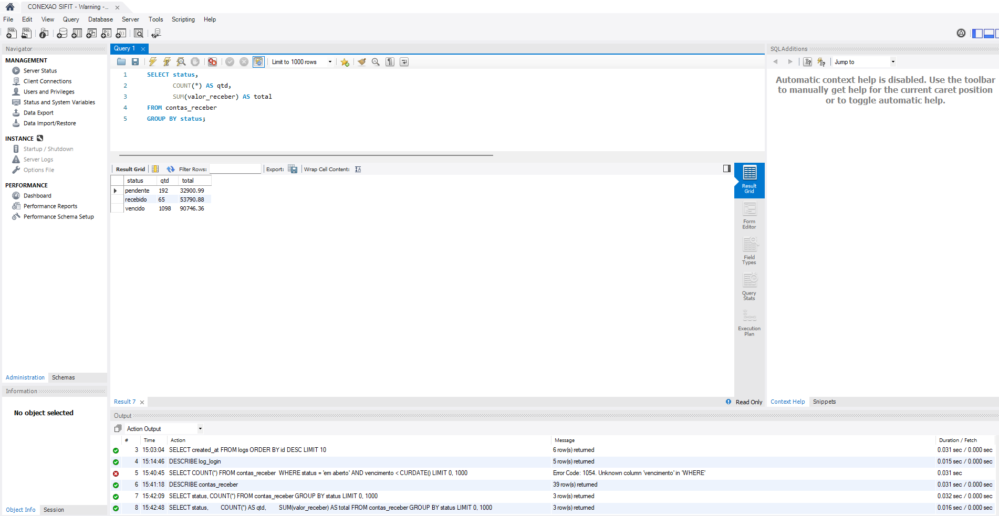

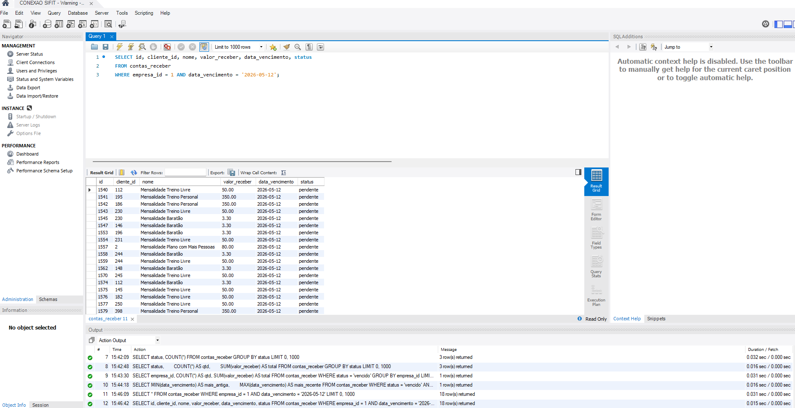

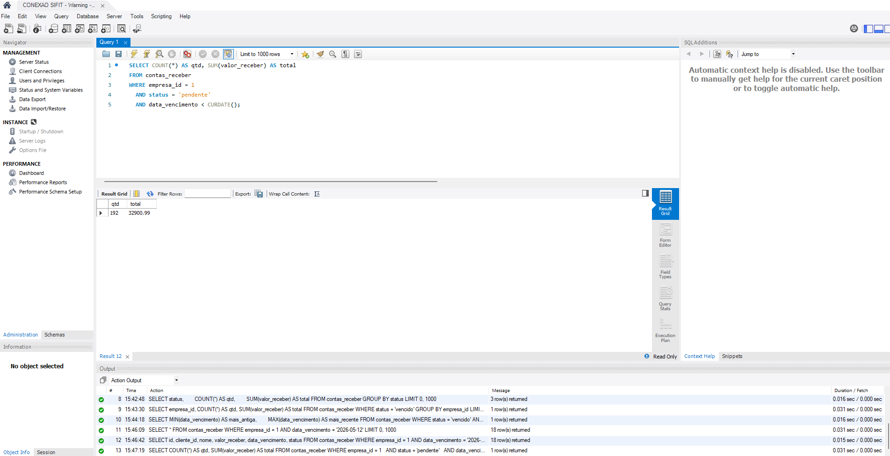

### BUG-006 — Indicadores zerados exibem variação percentual positiva no Radar de Evasão

**Severidade:** Média — induz o gestor a interpretar tendência de
crescimento em indicadores sem dados.
**Prioridade:** Média
**Módulo:** Dashboard / Inteligência de Retenção

**Pré-condição:** Estar autenticado no sistema.

**Passos para reprodução:**
1. Acessar a Página Inicial
2. No card "alunos em risco de evasão", clicar em "Ver detalhes"
3. Observar os quatro indicadores do Radar de Evasão

**Resultado esperado:** Indicadores sem dados devem omitir a variação
percentual ou sinalizar a indisponibilidade da comparação, uma vez
que não há base para cálculo de variação sobre valor zero.

**Resultado obtido:** Os quatro indicadores exibem valor 0
acompanhados de variações percentuais positivas: "Em risco alto"
+20%, "Em risco médio" +12%, "Sem treinar há 15+ dias" +15% e
"Mensalidades atrasadas" +18%. A tabela do modal informa "Nenhum
aluno em risco encontrado no momento".

**Análise técnica:** A requisição responsável por alimentar o Radar
de Evasão retorna array vazio (`[]`), confirmando a ausência de dados
provenientes do servidor. Os percentuais exibidos são, portanto,
valores estáticos definidos no front-end, sem relação com os dados
reais do sistema. Os quatro percentuais distintos permanecem
inalterados entre recarregamentos da página.

**Impacto:** O painel sugere crescimento em indicadores de risco que
não possuem dados, comprometendo a confiabilidade da informação
gerencial apresentada.

**Evidências:**

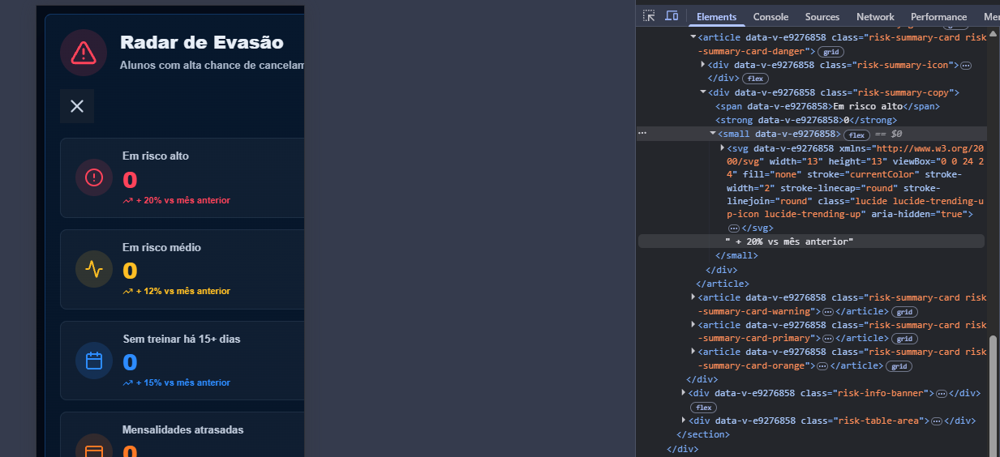

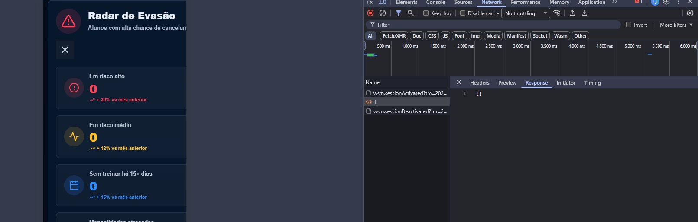